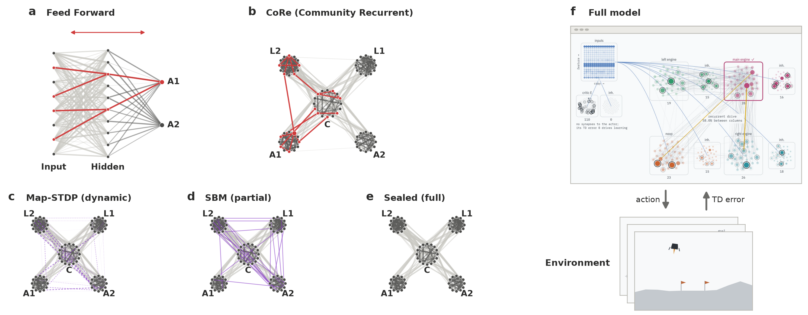

# CoRe

Community Recurrent spiking networks (CoRe-SNN): spiking networks whose communities serve as their states. Map-STDP
is a three-factor plasticity rule that learns a task by TD-modulated STDP, while a cost-modulated term makes a given
partition into modules (controller, actions, latents) the minimum-description-length partition of the network's walk.
This repository holds the library, the experiments on CartPole, Acrobot and LunarLander, and the final studies with
their trained models.

For a full visualization, check out the [Webpage](https://vikramr2.github.io/CoRe/): holding one episode of every best model, spike by spike, with each spike's sampled cause.



- `docs/derivation.md`: the model and its derivation. `docs/model.md`: the implemented model and its parameters.
- `reports/<study>/`: the final studies (pre-registration `README.md`, raw runs and `summary.md`).
- `models/`: the best trained model per arm of the reported studies (`models/README.md`).


## Modularity regimes

The studies compare the same network in three regimes, which differ in how its communities are kept apart:

| Regime | Cross-module synapses (outside routing) | Map term | Map-STDP v4 (`models.basic`) | TD-STDP backbone (`models.tdstdp`) |
| --- | --- | --- | --- | --- |
| **Partial** | present, shaped by the task term only | off | `--lam 0` | `--rec cols --lam 0` |
| **Dynamic** | present, weakened by the map term as the network learns | on | `--lam 0.05` | `--rec cols --lam 1` |
| **Full** | none: modules are built without them | off | `--lam 0 --p-cross 0` | `--rec cols --rec-full --lam 0` |

- **Partial**: the communities exist only through the wiring probabilities (dense within modules, sparse across).
  Nothing but the task keeps them apart.
- **Dynamic**: the map term (cost-modulated STDP) learns the modular structure, making the given partition the
  minimum-description-length one of the network's walk.
- **Full**: the structure the map term converges to, imposed from the start (same random draws, cross-module
  synapses masked out).

Study groups and model directories name the regime: `CartPole_<engine>_<regime>` in `emergent-v4` (e.g.
`CartPole_lif_dynamic`), `<Task>_cols_<regime>_<race variant>` in the race studies (e.g. `CartPole_cols_full_race_rp`;
the `base_*` groups have no recurrent columns).

## Setup

```bash
git clone https://github.com/vikramr2/CoRe.git && cd CoRe
git submodule update --init                   # docs/superneuro (reference only)
conda env create -f environment.yml           # Python 3.11, numpy, scipy, numba, gymnasium, box2d, superneuromat
conda activate map-stdp
pytest -q tests                               # optional: self-checks and fixed-seed regression tests (~2 min)
```

Run every command from the repo root as a module (`python -m ...`). Set the thread counts to 1 when you run many
jobs in parallel:

```bash
export OMP_NUM_THREADS=1 MKL_NUM_THREADS=1 OPENBLAS_NUM_THREADS=1 NUMBA_NUM_THREADS=1
```

## Run a trained model

Plasticity is off in both cases.

**TD-STDP backbone with race readout** (`models/race-*`, CartPole, Acrobot and LunarLander). The script prints the
return of each episode and their mean:

```bash
python models/evaluate.py models/race-cartpole/CartPole_cols_full_race_rp/s7005.npz --episodes 20 --seed 1
python models/evaluate.py models/race-lunarlander/LunarLander_cols_partial_race_e/s7219.npz --episodes 20
```

**Map-STDP, model v4** (`models/emergent-v4`, CartPole). The run's training record supplies the final readout gain.
The script plays the model intact and with its latent modules ablated, and writes the returns to `--out`:

```bash
python -m experiments.ablate --family v4 --model models/emergent-v4/CartPole_lif_dynamic/s2017.npz \
    --run reports/emergent-v4/runs/CartPole_lif_dynamic/s2017.json --episodes 20 --out out.json
```

The policies are stochastic, so returns vary with the evaluation seed. The full set of models (every seed) is not in
git; see `models/README.md`.

## Train a model

Add `--save-model PATH.npz` to save the final weights. Results go to `experiments/results/` unless `--out` is given.

**Map-STDP, model v4, on CartPole** (the `emergent-v4` arms). The engines are flow (`--backend flow`) and the
spiking engines branching, QIF and LIF (`--backend spiking --engine numpy | qif | lif --heads 8 --readout diffbound
--match-scales`). `--beta-max` is 16, except 1.6 for LIF. Both commands below train the dynamic regime; swap
`--lam 0.05` for another regime's flags from [Modularity regimes](#modularity-regimes):

```bash
python -m models.basic --task CartPole --seed 0 --backend flow --rule emergent --td-norm 0.04 --p-cc 0 \
    --beta-kappa 0.01 --eta 5 --beta-max 16 --lam 0.05 --episodes 1500 --save-model v4_flow.npz
python -m models.basic --task CartPole --seed 0 --backend spiking --engine lif --rule emergent --td-norm 0.04 \
    --p-cc 0 --beta-kappa 0.01 --eta 5 --beta-max 1.6 --heads 8 --readout diffbound --match-scales --lam 0.05 \
    --episodes 1500 --save-model v4_lif.npz
```

**TD-STDP backbone (Chung & Kozma 2020) with recurrent action columns and the race readout:**

```bash
# CartPole: the published backbone (no columns), then the full regime with the race readout
python -m models.tdstdp --task CartPole --seed 0 --engine nlif --rate-target 40 --block 20 --fast \
    --rate-match-rec --ent-match-rec --save-model ck.npz
python -m models.tdstdp --task CartPole --seed 0 --engine nlif --rate-target 40 --block 20 --fast \
    --rate-match-rec --readout race --race-reprobe 50 --chi-rec 0.3 --rec cols --rec-full --lam 0 --save-model race.npz
# LunarLander: the partial regime with the race readout (10000 episodes; hours per run)
python -m models.tdstdp --task LunarLander --seed 0 --engine nlif --rate-target 40 --block 20 --fast \
    --rate-match-rec --eta-cal --readout race --rate-cost 5e-4 --rate-floor 0.5 --race-theta 26 --chi-rec 0.3 \
    --rec cols --lam 0 --save-model ll.npz
```

The exact command of every reported run is in `reports/<study>/manifest.json`. To retrain every run of a race study
and check it against the report:

```bash
models/reproduce.sh race-acrobot 20      # every run, 20 in parallel, with --save-model into archive/models/
python models/verify.py race-acrobot     # the returns match the reported runs exactly
```

New final studies are declared in `experiments/report.py` and launched with `python -m experiments.report run
<study> --workers N`, which writes only into `reports/<study>/`.

<!-- `CLAUDE.md` lists the other experiment scripts and the repository's conventions. -->
